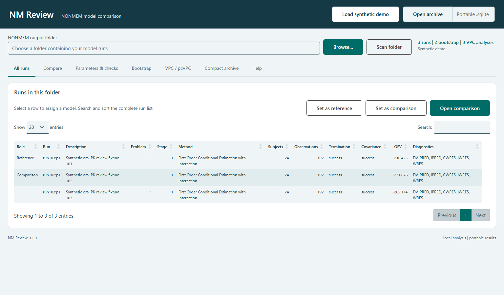

# NM Review

A local R Shiny application for reviewing completed NONMEM runs and keeping compact PsN bootstrap and prediction-corrected VPC results.



Screen examples: [model comparison](docs/screenshots/compare.png), [bootstrap](docs/screenshots/bootstrap.png), [VPC / pcVPC](docs/screenshots/pcvpc.png). Screenshots show the bundled synthetic data.

## Start on Windows

Install R 4.3 or later. Open a terminal in this folder and run the one-time setup:

```powershell
Rscript --vanilla tools/setup.R
```

Then double-click **Launch NM Review.cmd**, or run:

```powershell
Rscript --vanilla tools/start.R
```

From an R session with the package installed:

```r
nmreview::run_app()
```

The application binds to `127.0.0.1`. Setup downloads R packages from CRAN. Ordinary use operates on the local computer and uses bundled browser assets. Click **Load synthetic demo** to try it without a NONMEM installation.

## Review a project

1. Click **Browse…** to select a NONMEM output folder using the native Windows folder dialog. You can also enter a path and click **Scan folder**.
2. **All runs** lists the discovered estimation results. Search, sort, select a row, then click **Set as reference** or **Set as comparison**. Both models can also be changed independently on **Compare**.
3. **Compare** shows AIC, the number of estimated parameters, and shrinkage alongside the run status. Expand **Parameters & checks** for estimates, ETABAR, matrices and convergence evidence. **Code differences** shows changes in the selected control blocks. The **Tree** view in **All runs** uses declared or manually assigned parents.
4. In **Inspector**, choose axes and subjects, then add numeric, category or missing-value filters. Select a plotted observation or displayed row for its source and individual profile. Plot and source-table options are expandable.
5. **Evaluation** contains VPC/pcVPC, bootstrap, and a sensitivity comparison of completed runs. Use **Compact archive** in the header to save the results and review settings. **Open archive** can reopen files written by version 0.1.0.

Native dialogs browse folders on the computer running R. Use a local R session for Windows Explorer access.

## Compact storage

| Results | Kept in the archive | Available later |
| --- | --- | --- |
| Estimation | Model summaries, parameter estimates, diagnostics metadata, relative source inventory | Model table and numerical review |
| Optional model rows | Selected observation and event tables | Linked observations, residual candidates, individual plots |
| Bootstrap | Replicate estimates, original estimate, statuses, inclusion reasons and stored summary | Distributions and percentile intervals |
| VPC / pcVPC | Correction metadata, strata, bin boundaries, observed and simulated percentiles and confidence limits | Replot the same binning and correction |

Full bootstrap execution directories, compiled NONMEM artifacts and large simulation matrices are omitted. Changing VPC bins, strata or correction requires the corresponding observation and simulation rows. An archive records its source provenance and included data. Saving validates an independent reload before the file is finalized. Original files are read only.

## Scope

The initial target is continuous-response NONMEM 7 estimation output and PsN bootstrap/VPC results. Diagnostic tables are found from `$TABLE` declarations and verified against their headers. Multiple problems and estimation stages retain their identity. Missing columns, uncertain matching and incomplete results are surfaced in the interface.

The OFV difference uses comparison minus reference. It is withheld when the reader cannot verify the required compatibility. Residual candidate flags are review aids and do not modify the analysis. Check the original model, data conventions and estimation settings when interpreting results.

All included data and results are generated synthetic examples, **not clinical data and not actual NONMEM fits**. The demo generator and its expected values are included for reproducibility. See [supported formats](docs/formats.md) and [verification](docs/verification.md) for tested cases and limits.

## Development

```powershell
R CMD build .
R CMD check --no-manual nmreview_0.2.0.tar.gz
```

Tests use synthetic fixtures. External public fixtures, when used for verification, are downloaded into temporary directories and are not redistributed. Runtime patient data and archives belong outside this repository. The repository has no telemetry or automatic uploads.

Version 0.1.0 passed local `R CMD check --no-manual` with no errors, warnings or notes. The browser workflow and pinned public output fixtures also passed. A manual Windows desktop check confirmed folder selection through **Browse…**. See the [verification record](docs/verification.md).

## License and attribution

Original application code and the generated synthetic fixtures are MIT licensed. R packages retain their respective licenses and are installed separately. This project references NONMEM and PsN output formats and uses an original interface. See [third-party references](docs/sources.md).

The package maintainer contact in `DESCRIPTION` uses the reserved `example.org` domain. Set the release owner's public contact before publishing the R package. GitHub repository creation and public release are performed by the repository owner.
